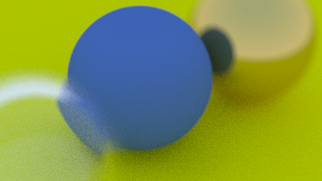
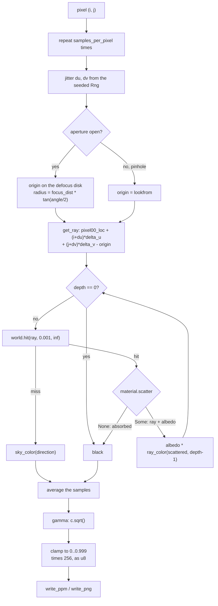
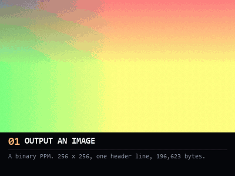
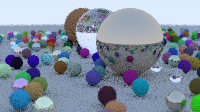

# grazing-incidence

A ray tracer in Rust — diffuse, metal and dielectric materials, depth of field,
antialiasing, and a hand-rolled PNG encoder. **Zero dependencies.**



*`images/final-spheres.png` — 400×225 at 100 samples per pixel, the `--scene
spheres` default. A 20-degree lens at `(-2, 2, 1)` behind a 10-degree aperture
focused at 3.4, so the middle ball is sharp while the ground and the outer balls
smear. Rendered by `cargo run --release -- --out images/final-spheres.png`.*

## Status

| | |
|---|---|
| Milestones landed | 15 of 15 |
| Tests | 173, all passing |
| Warnings | none |
| Dependencies | none, by design |
| Scenes | `spheres`, `cover` |

## How a pixel becomes a colour

Everything else in this README is a table because a table is the better shape
for it. This is the one part that is genuinely a flow — a loop, a branch, and
a recursion — so it gets a diagram.



Four things in that diagram are load-bearing, and each was a bug at some point:

- **`t_min` is `0.001`, not `0`.** A ray leaving a surface immediately re-hits it
  because of floating-point rounding. Zero is the shadow acne.
- **Gamma is applied at the end, never during accumulation.** `Image.pixels`
  stays linear, so a test can assert against it directly.
- **The clamp is `0.999`, not `1.0`,** so a fully lit channel encodes to 255
  rather than 256.
- **The aperture check is per sample,** which is why the background smears while
  the focal plane stays sharp.

## The progression



*Every frame is a real render, produced by checking out the commit that
introduced the feature and running that commit's own binary. Nothing here is
reconstructed or restyled.*

`python scripts/make-progression.py` regenerates it. The script that builds it
doubles as the narration — each beat's caption is the claim that milestone
makes, written to be read at 400 pixels wide.

## Milestones

Each row is one commit in `git log`, gated on a clean build, a green suite, and
a render you have actually looked at. Read it top to bottom as the build order.

| # | Lands | Visible change |
|---|---|---|
| 1 | `image` (P6 PPM), `renderer` | a vertical gradient |
| 2 | `vec3` | none — arithmetic only |
| 3 | `ray` | sky gradient |
| 4 | `sphere` | one sphere against sky |
| 5 | `hittable`, `interval` | ground plus two balls |
| 6 | `camera` | none — a pure refactor |
| 7 | `rng` | antialiasing, smoothed silhouettes |
| 8 | `Material::Lambertian` | soft shadows, gamma on |
| 9 | `Material::Metal` | fuzzy reflections |
| 10 | `Material::Dielectric` | refracting glass |
| 11 | camera rewrite, full CLI | reframed |
| 12 | camera aperture | out-of-focus background |
| 13 | `image` (deflate), `png` | the same image, as `.png` |
| 14 | `Scene::Cover` | a field of random spheres |

Two commits render identically to their predecessor by design. Isolating a
refactor from any visual change is what makes it reviewable at all.

## Scenes

| Scene | What it is |
|---|---|
| `spheres` | A ground plane, a matte ball at `(0, 0, -1.2)`, a glass ball at `(-1, 0, -1)` with a hollow glass bubble of radius 0.4 inside it, and a metal ball at `(1, 0, -1)`. |
| `cover` | A gap-cleared grid of ~484 randomly placed and randomly materialed spheres, plus three deliberate foreground balls. |

```sh
# the default image
cargo run --release -- --out images/out.png

# the cover, small. At its full 1200x675 and 500 samples that is 405 million
# primary rays against ~488 spheres -- start small.
cargo run --release -- --scene cover --width 200 --samples 8 --out images/cover-probe.png
```



*`images/cover-probe.png` — `cover` at 200×112 and 8 samples per pixel. Noisy
on purpose: it is evidence that the cover path and the PNG encoder both work,
not a finished render.*

## Materials

Three variants of one enum, each answering the same question — given a ray and
a surface, where does it go, and how much light comes back?

| Material | Where the ray goes | Attenuation |
|---|---|---|
| `Lambertian` | `normal + a random unit vector`, with a guard that falls back to `normal` if the two cancel exactly | `albedo` |
| `Metal` | Mirror the ray about the normal, then blur by `fuzz` clamped to `[0, 1]`. If the result points below the surface, absorb | `albedo` |
| `Dielectric` | Refract, unless the ray is past the critical angle (`ratio * sin(theta) > 1`) or Schlick's approximation says reflect | none — `(1, 1, 1)` |

The signature is `scatter(&self, ray, &rec, rng) -> Option<(Ray, Color)>`. The
`Option` is how absorption is expressed; returning the attenuation alongside the
ray from the first material meant adding metal later was not a breaking change.

## How it is built

| Choice | What it buys |
|---|---|
| `trait Hittable` returning `Option<HitRecord>` | No boolean-plus-out-parameter intersection, which is the easiest thing in this kind of renderer to get wrong |
| `Material` as a flat **enum** | Owned, movable, exhaustively matched — and `HitRecord` stays free of lifetimes and reference counting |
| `Result` instead of exceptions | Errors carry the flag or value that caused them |
| A hand-rolled PCG32 | Deterministic, reproducible renders with no dependency |
| **Zero dependencies** | A ray tracer needs no crates, and writing the PRNG, both image encoders, CRC-32, Adler-32, DEFLATE, argument parsing and error types by hand is the point |

## Design decisions

The ones where a reasonable person might have chosen differently:

| Decision | Why |
|---|---|
| **One evolving program, one commit per milestone** | One program that grows, rather than a tree of small binaries left behind. Git already provides replayability. |
| **Zero dependencies** | Everything is written here, which is both the honest answer and the educational one. |
| **Deterministic by default** | A fixed seed, overridable with `--seed`, so identical code yields byte-identical images. A diff in `images/` always means a real change. |
| **P6 PPM, not P3** | The same image a quarter of the size: binary, one `write` instead of ~270,000 separately formatted numbers. |
| **Unit tests on the mathematics** | Not golden images. There is no stable output to pin, and golden PPMs break under any refactor. Committed images are visual artifacts, not fixtures. |
| **Right-side-up images** | The naive camera — anchor on the viewport's bottom-left corner, count rows upward — puts the bottom of the scene in the image's top row, because PPM writes the first row as the top. The camera here anchors top-left and `pixel_delta_v` points down, so rows fall where they should with no correction at all. See `AGENTS.md`. |
| **Hand-rolled PNG** | Committed PPMs are a few hundred KB and do not preview on GitHub. LZ77 plus a fixed-Huffman DEFLATE gets them under a tenth of that, from scratch. |

## Module layout

This was a dependency diagram until it was drawn and measured: Mermaid's layout
ignored the intended layering, and at 1400 pixels wide it was unreadable in a
README column. A table says it better.

| Module | Role | Depends on |
|---|---|---|
| `main.rs` | parses argv, picks the encoder from the extension | `renderer`, `cli` |
| `cli.rs` | `Options`, flag parsing, `--help` | `camera`, `scene`, `error` |
| `renderer.rs` | seeds one `Rng`, builds the world, hands off to the camera | `camera`, `cli`, `scene`, `image`, `rng`, `error` |
| `camera.rs` | the pixel loop, the aperture, `ray_color` | `scene`, `hittable`, `image`, `ray`, `rng`, `error` |
| `scene.rs` | `spheres` and `cover` | `sphere`, `material`, `hittable`, `rng`, `error` |
| `hittable.rs` | `Hittable`, `HitRecord`, `HittableList` | `material`, `ray`, `sphere`, `vec3` |
| `sphere.rs` | the ray-sphere quadratic | `hittable`, `material`, `ray`, `vec3` |
| `material.rs` | `Lambertian`, `Metal`, `Dielectric`, `scatter` | `hittable`, `ray`, `rng`, `vec3` |
| `image.rs` | pixel buffer, PPM writer, encoder dispatch | `error` |
| `png.rs` | CRC-32, Adler-32, LZ77, fixed-Huffman DEFLATE | `image` |
| `ray.rs` | origin, direction, `at(t)` | `vec3` |
| `rng.rs` | PCG32, plus `unit_vector` and `in_unit_disk` | `vec3` |
| `vec3.rs` | the vector type and its arithmetic | — |
| `interval.rs` | a real interval with inclusive bounds | — |
| `error.rs` | `RenderError` | — |

One relationship here is not a layering, and it is the only thing a diagram
would have told you that this table cannot: `hittable`, `material` and `sphere`
are **mutually recursive**. A `HitRecord` carries a `Material`, a `Material`
scatters against a `HitRecord`, and `sphere` implements `Hittable`. That cycle
is why `HitRecord` is a plain struct rather than a trait object.

Paths outside `src/`: `images/` holds committed renders, `AGENTS.md` is the
working agreement for coding agents, and `scripts/make-progression.py` builds
the GIF above.

### A note on `images/`

There is one scene graph, so most of the later milestones all render the same
picture at the same settings. Committing a dozen near-identical files would
record the build order rather than the renderer, so `images/` holds what the
renderer actually produces: the current scene, and a small probe of the cover
path.

## Not in scope

- Quads, triangles, textures, transforms, emissive lights, volumetric or
  participating-media rendering.
- Parallel or multithreaded rendering.
- A reusable general-purpose renderer library — this is an application, not a crate
  other projects should depend on.

## Building

Requires a Rust toolchain (stable). No build system beyond Cargo.

```sh
cargo build --release
cargo test
cargo run --release -- --help
```

Windows users without MSVC can install the GNU host:

```sh
rustup-init.exe --default-host x86_64-pc-windows-gnu --default-toolchain stable
```

## License

MIT — see [`LICENSE`](LICENSE).